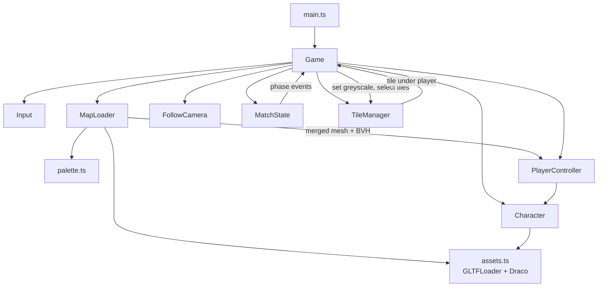

# Rang Chase

A browser-based 3D chase game built on Three.js. One chaser calls a colour, runners must stand on a hidden object of that colour to stay safe, and then the chaser hunts whoever is exposed.

The repository is `chase-runner`. The game is called **Rang Chase** in the code and map docs, and **Color Chase** in the design doc (`game-logic-and-build-plan.md`). It is the same game.

**Status: early single-player prototype.** The map, character, movement, camera, collision, match phases and tile mechanics run locally in one browser tab. Networking, tagging and the chaser role are not built yet (see [Development Status](#development-status)).

---

## Game Concept

- **Genre:** multiplayer tag / chase game with a colour-matching safety rule (planned as real-time multiplayer; currently local only).
- **Setting:** a low-poly city map: a central park, a road network with a roundabout and a crossroad, a commercial block, two large buildings and an amphitheatre.
- **Camera:** angled overhead follow camera.
- **Platform:** desktop web browser (keyboard and mouse). Mobile support is not documented.

**Roles**
- **Chaser:** picks a colour each round, then hunts.
- **Runners:** must stand on an object of the called colour to be safe.

**Match flow** (from `game-logic-and-build-plan.md`, implemented in `src/game/MatchState.ts`)

| Phase | Default length | What happens |
|---|---|---|
| `LOBBY` | until start | Waiting state. |
| `BLIND_SCATTER` | 10 s | Map is rendered black and white. The chaser's colour is picked. Runners move freely. |
| `REVEAL` | instant | Map snaps to full colour. Valid tiles are chosen (they look like normal objects). |
| `SETTLE` | 3 s | Runners rush to a valid tile and must keep holding it. Tile capacity is enforced. |
| `OPEN_HUNT` | 20 s | Tiles stop being safe. Chaser can move and tag exposed runners. |
| `MATCH_END` | until restart | Result: `CHASER_WIN` or `RUNNER_WIN`. |

**Rules from the design doc**
- Valid tile count is `ceil(active_players / max_players_per_tile)`.
- Safety needs continuous contact with a valid tile. Stepping off drops it immediately.
- Players cannot stand in for tiles.
- Chasers win if every runner is tagged before the hunt timer ends. Otherwise runners win.
- One round per match.

---

## Implemented vs Planned

| Feature | Status | Evidence |
|---|---|---|
| Map loading and role-based parsing | Implemented | `src/map/MapLoader.ts` |
| Colour palette rebuilt from material names | Implemented | `src/map/palette.ts` |
| Merged BVH collision (capsule vs map) | Implemented | `src/map/MapLoader.ts`, `src/player/PlayerController.ts` |
| Walk, run, backward walk, jump, double jump, step-up over kerbs | Implemented | `PlayerController.ts` |
| Angled follow camera, orbit, zoom, pointer lock, occlusion pull-in | Implemented | `src/player/FollowCamera.ts` |
| Rigged character with 6 clips, per-player colours | Implemented (one character only) | `Character.ts`, `public/models/character_a.glb` |
| Match phase state machine with timers | Implemented (client-side copy) | `MatchState.ts` |
| Black-and-white blind scatter and colour reveal | Implemented | `TileManager.setGreyscale` |
| Valid tile selection, occupancy cap, hold/release | Implemented (client-side stand-in for the server) | `TileManager.ts`, `Game.updateSafety` |
| HUD (fps, phase, timer, tile, position, speed, animation) | Implemented | `Game.drawHud` |
| Match result events | Partial | `MatchState.allRunnersTagged()` exists but nothing in `src/` calls it. `OPEN_HUNT` can only end by timer (`RUNNER_WIN`). |
| Chaser movement | Not implemented | `chaserCanMove` getter exists but is unused. The local player is always a runner. `?role=chaser` only changes the outfit colour. |
| Tagging / hit reaction | Not implemented | No tag logic in `src/`. No hit animation clip. |
| Colyseus server, multiplayer, server authority | Planned | Described in the build plan. No Colyseus dependency or server code in the repo. |
| Admin config UI, lobby | Planned | `RoomConfig` type exists. Only URL overrides are available. |
| Disconnect grace period | Planned | Build plan only. |
| Other three characters rigged | Planned | See `README-APP.md`. |

---

## Game Engine and Technology Stack

**There is no traditional game engine.** The game is custom code on top of the Three.js rendering library, running in the browser. This was identified from `package.json`, `index.html`, and the absence of any Unity, Unreal or Godot project files.

| Area | Technology | Version |
|---|---|---|
| Rendering | [Three.js](https://threejs.org/) (WebGL) | `^0.180.0` (locked 0.180.0) |
| Collision | `three-mesh-bvh` (BVH raycast and capsule shapecast) | `^0.9.14` (locked 0.9.14) |
| Language | TypeScript, strict mode | `^5.6.3` |
| Dev server / bundler | Vite | `^5.4.10` (locked 5.4.21) |
| Mesh compression | Draco (decoder in `public/draco/`) | bundled build |
| Asset format | glTF binary (`.glb`) | |
| Content pipeline | Blender (Python scripts) | Version not stated. `README-APP.md` mentions Blender 4.4+ behaviour. |
| Animation source | Mixamo FBX clips | |
| Character source meshes | Meshy AI export (filename in `characters/raw/`) | |
| Asset optimisation | `gltf-transform` (referenced in `README-MAP.md`) | Not a project dependency |
| Planned networking | Colyseus over WebSockets (Node.js) | Planned only, not installed |
| CI | GitHub Actions | `.github/workflows/daily-commit.yml` |

Languages in the repo: TypeScript (game), Python (Blender scripts), JavaScript (`scripts/shot.mjs`, Draco decoders), HTML.

Not identifiable from the repo: Blender version used, Node.js version, target browsers, any audio system (no audio code or files were found).

---

## Installation and Setup

Requirements: Node.js and npm (no version pinned in the repo).

```bash
npm install
```

## How to Run

```bash
npm run dev       # Vite dev server at http://localhost:5173
npm run build     # tsc --noEmit + vite build
npm run preview   # serve the production build
npm run smoke     # headless screenshot (needs the dev server running)
npm run build:char  # rebuild the character .glb (needs Blender and local Mixamo FBX files)
```

**Controls**

| Input | Action |
|---|---|
| W A S D / arrows | Move (camera-relative) |
| Shift | Run |
| Space | Jump (a second press in the air gives a double jump) |
| Q / E | Turn the camera |
| Mouse drag | Orbit camera |
| Click | Capture pointer for mouse look (Esc releases) |
| Wheel | Zoom |

**URL parameters** (testing)

| Page | Parameter | Effect |
|---|---|---|
| `/` | `?char=<path>` | Load a different character model |
| `/` | `?role=chaser\|runner` | Chaser outfit colour (cosmetic only for now) |
| `/` | `?scatter=` `?settle=` `?hunt=` | Phase lengths in seconds |
| `/char.html` | `?char=` `?i=` `?clip=` `?t=` `?bones=1` | Standalone character viewer |

`scripts/shot.mjs` defaults to a Windows Chrome path. Set the `CHROME` environment variable on other systems. `export_map.py` has a hard-coded Windows `EXPORT_PATH`. Both are visible in the source.

---

## Documentation Structure

Three README files exist in the repository. There are also several non-README docs, listed below them.

| README | Path | Folder / module | What it covers |
|---|---|---|---|
| Client README | [`README-APP.md`](README-APP.md) | Root, `src/`, `scripts/` | Three.js client: how to run, source layout, character pipeline (Mixamo to `.glb` via Blender), why the map and characters need runtime colour, collision approach, debugging tools (`shot.mjs`, `char.html`), manual test checklist, and what is not done yet. **Start here for code.** |
| Map handover | [`README-MAP.md`](README-MAP.md) | Root, `export_map.py`, `public/models/map.glb`, `characters/` | Blender map: scale and coordinates, full layout with measurements, collections, art-style rules, tile coverage and the `export_map.py` pipeline, naming convention (`Role_Kind_Index`), Blender gotchas, outstanding map work, character optimisation and rigging notes. **Start here for the map and assets.** |
| Draco decoder README | [`public/draco/README.md`](public/draco/README.md) | `public/draco/` | Third-party Draco readme: what the decoder files are, default vs glTF variants, `DRACOLoader` usage. |

Other documents:

| File | Purpose |
|---|---|
| [`game-logic-and-build-plan.md`](game-logic-and-build-plan.md) | Game rules, match state machine, draft data model, server-authority rule, tech plan and 10-step build order. |
| `part1.txt` to `part4.txt` | Original Blender prompts for a "Green Valley Park" environment (layout, playground, fountain/gazebo, landscaping). `README-MAP.md` says to use them only as layout guidance, because they ask for photoreal PBR rendering that conflicts with the flat, lightweight style. |
| `.github/daily-log/log.md` | Log file appended to by the scheduled workflow. |

**Referenced but not in the repo:** `map-design.md`, `game-design.md`, the Blender source `.blend`, `characters/mixamo_out/` and `characters/mixamo_upload/` (`*.fbx`, `*.obj`, `*.zip` are git-ignored). Treat details that depend on them as unverified.

**Naming note:** the docs call the map file `rang_chase_map.glb`. The file actually used by the game is `public/models/map.glb`.

---

## Project Directory Structure

```
chase-runner/
├── README.md                       Main documentation (this file)
├── README-APP.md                   Client / code documentation
├── README-MAP.md                   Blender map and asset handover
├── game-logic-and-build-plan.md    Game rules and build plan
├── index.html                      Game page (canvas mount, HUD, loading overlay)
├── char.html                       Standalone character viewer page
├── package.json / package-lock.json
├── tsconfig.json
├── export_map.py                   Blender script: rename, split, scatter, export map .glb
├── part1.txt … part4.txt           Original park-generation prompts (reference only)
├── src/
│   ├── main.ts                     Entry point: creates Game, loads, starts
│   ├── charview.ts                 Entry point for char.html
│   ├── three-augment.d.ts          Type augmentation for three
│   ├── core/
│   │   ├── Game.ts                 Scene, lights, fixed-step loop, HUD, phase hooks
│   │   ├── Input.ts                Keyboard state to movement intent
│   │   └── assets.ts               Shared Draco-enabled GLTFLoader
│   ├── map/
│   │   ├── MapLoader.ts            .glb to tiles, spawns, merged BVH collider
│   │   └── palette.ts              Material name to colour rules
│   ├── characters/
│   │   └── Character.ts            Clip playback, root-motion strip, outfit colours
│   ├── player/
│   │   ├── PlayerController.ts     Capsule-vs-BVH movement, jumping, animation states
│   │   └── FollowCamera.ts         Angled-overhead follow camera
│   └── game/
│       ├── MatchState.ts           Phase state machine and room config
│       └── TileManager.ts          Tile colours, greyscale, valid-tile selection, holding
├── public/
│   ├── models/
│   │   ├── map.glb                 Game map (2.8 MB, Draco)
│   │   └── character_a.glb         Rigged character, 6 clips (1.2 MB)
│   └── draco/                      Draco decoders (+ README.md, gltf/ variants)
├── characters/                     Static character meshes (not yet rigged)
│   ├── *.glb                       Originals as supplied (24-28 MB each)
│   ├── fitted/                     Height and origin corrected only
│   ├── optimized/                  Game-ready static meshes (0.37-0.46 MB each)
│   └── raw/                        One raw Meshy export
├── scripts/
│   ├── build_character.py          Blender headless: merge Mixamo clips, export .glb
│   └── shot.mjs                    Headless Chrome screenshot / smoke test
└── .github/
    ├── workflows/daily-commit.yml  Scheduled workflow
    └── daily-log/log.md
```

Generated or ignored folders (`node_modules/`, `dist/`) are not shown.

**Key directories**
- `src/` holds all game code. `game/` is deliberately free of rendering and networking so it can later move server-side.
- `public/models/` holds the only assets the game loads at runtime.
- `characters/` holds source and intermediate assets for four static characters. None of them is loaded by the game yet.
- `scripts/` and `export_map.py` are offline tooling and are not part of the runtime.

---

## Technical Architecture

The client is a single Three.js scene driven by one `Game` class. Simulation runs on a fixed 60 Hz step (max 5 steps per frame). Rendering and the match timer run per frame.



**How it fits together**
1. `main.ts` builds `Game`, loads assets with a progress label, then starts the render loop. It exposes `window.__ready` and `window.__game` for the smoke test.
2. `MapLoader` reads the `.glb` and classifies every node by name prefix (`Tile_`, `Prop_`, `Building_`, `Ground_`, `Road_`, `Collider_`, `Spawn_`). It collects tiles and spawn points and merges collidable meshes into one geometry with a `MeshBVH`. Boundary walls are added in code. `Prop_Runner*` nodes are removed. `Prop_` meshes are included in collision in the current code, although `README-APP.md` says props are excluded, so that doc is out of date on this point.
3. `palette.ts` colours the map from material names, because the exported map has no colour data. Tiles take their colour from the `Tile_<Colour>` name.
4. `PlayerController` moves a capsule through the BVH, with gravity every step, grounded detection from push-out direction, and kerb step-up. It chooses animation clips from speed and state.
5. `MatchState` runs the phase timers and fires `onPhase` events. `Game.onPhase` reacts: greyscale on during `BLIND_SCATTER`, a random colour picked, valid tiles selected at `REVEAL`, cleared at `MATCH_END`.
6. `TileManager` owns greyscale, valid-tile selection (partial Fisher-Yates from the called colour's pool), occupancy and `tileAt` lookups. `Game.updateSafety` re-tests contact every frame.

Everything networking-related is a stub: the local player id is the constant `"local"`, and comments mark where Colyseus is meant to replace client-side logic.

**Map data** (from `README-MAP.md`): 8 tile colours (Red, Orange, Yellow, Green, Cyan, Blue, Purple, Magenta), 266 tiles per colour, 2128 tiles total, 9 spawn markers (8 runner, 1 chaser). The spawn positions are placeholders per the map doc. Doc figures for node and triangle counts were not re-measured. Note the code comment in `Game.ts` says ~1.2 M collision triangles while `README-APP.md` says ~330 k.

---

## Game Assets and Resources

- **Map:** `public/models/map.glb`, flat-colour low-poly city, no baked colour (rebuilt at runtime).
- **Character:** `public/models/character_a.glb`, one rigged character (clips `Idle`, `Walk`, `Run`, `Jump`, `JumpUp`, `WalkBack`). The source atlas is colourless, so skin and outfit colours are set in code. The chaser outfit is red, and runners use a list of 8 colours.
- **Unrigged characters:** four static `.glb` files in `characters/` (two characters × two expressions), in original, fitted and optimised versions.
- **Audio:** none found.
- **UI:** a text HUD plus a loading overlay. No menus or lobby screens.

---

## Development Status

Following the 10-step build order in `game-logic-and-build-plan.md` and the notes in `README-APP.md`:

- **Done:** map pipeline, character pipeline (one character), single-player movement and camera, local match state machine, local tile selection and holding.
- **Not done:** Colyseus room, server-side match state, server tile selection, tagging, chaser role, admin config UI, disconnect grace, polish (score, end screen, sound).

**Known gaps documented by the authors**
- Only one character is rigged.
- No tag/hit-reaction, strafe or landing animations.
- Map outstanding items: Building B extension, rear service road and tree ring placement, placeholder spawn points (`README-MAP.md` §9).
- Open design questions: room size limits and chaser assignment rules (build plan).

---

## Contribution Guidelines

No contribution guide or licence file is present in the repository. Before changing the map pipeline, read `README-MAP.md` §6b and §7. Before changing gameplay code, read `README-APP.md`.

The repo includes `.github/workflows/daily-commit.yml`, which runs daily and appends lines to `.github/daily-log/log.md` with automated commits. Keep it in mind when reading the commit history.
